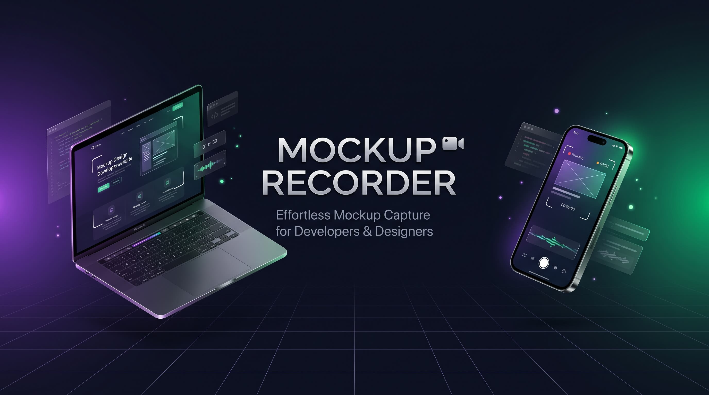

<p align="center">
  
</p>

<h1 align="center">Mockup Recorder 🎬</h1>

<p align="center">
  <strong>Automated cinematic screen recorder & 3D device showcase generator for developers.</strong>
</p>

<p align="center">
  <a href="https://github.com/PourhajiDeV/Mockup-Recorder/releases"></a>
  <a href="https://nodejs.org"></a>
  <a href="https://playwright.dev"></a>
  <a href="https://ffmpeg.org"></a>
  <a href="LICENSE"></a>
  
</p>

---

## ⚡ Overview

Instead of manually capturing screen recordings, importing them into video editors, and manually aligning them to mockups:

1. **Launches Target URL:** Connects directly to local dev servers (`localhost:3000`) or public URLs.
2. **Smooth Inertial Scrolling:** Automatically detects total page scroll height and executes cubic bezier scrolling.
3. **3D Stage Assembly:** Injects both desktop and mobile views into realistic, animated MacBook Pro and iPhone mockups with active reflections and camera details.
4. **Master Rendering:** Encodes directly to high-bitrate 60fps `.mp4` using FFmpeg.

> [!TIP]
> Ideal for quickly creating launch videos, feature announcements, and portfolio previews for Twitter, LinkedIn, and Instagram.

---

## 📦 Prerequisites

Ensure you have **Node.js** and **FFmpeg** installed and accessible in your system's `PATH`:

| Platform | Command / Source |
| :--- | :--- |
| **Ubuntu / Debian** | `sudo apt install ffmpeg` |
| **macOS** | `brew install ffmpeg` |
| **Windows** | `winget install Gyan.FFmpeg` or via [ffmpeg.org](https://ffmpeg.org/download.html) |

---

## 🚀 Quick Start

### 1. Clone & Install

```bash
git clone [https://github.com/PourhajiDeV/Mockup-Recorder.git](https://github.com/PourhajiDeV/Mockup-Recorder.git)
cd Mockup-Recorder
npm install
```

### 2. Register Global Command

```bash
npm link
```

*(On Linux / macOS, ensure execution permissions if prompted: `chmod +x studio.js`)*

---

## 🛠️ Usage

Run the tool anywhere in your terminal:

```bash
web-record
```

Follow the interactive configuration prompt:

```text
────────────────────────────────────────────────────────────────────────
  ● SHOWCASE STUDIO ENGINE                                  [ULTRA V6.0]
────────────────────────────────────────────────────────────────────────

  ✔ Target:    http://localhost:3000
  ✔ File Name: Release_v1
  ✔ Brand:     POURHAJI DEV
  ✔ Settings:  COMBO3D | 9x16_Vertical | 15s

  🚀 Starting recording pipeline...
```

* **Aspect Ratios Supported:** `9:16 Vertical` (Reels/Shorts), `16:9 Landscape` (YouTube), `3:4 Portrait` (Posts).
* **Presets:** Master Studio (CRF 16) or Lightweight Web (CRF 26).
* **Destination:** All encoded files are automatically outputted to `./output/`.

---

## ✨ Features

- **Zero Scrollbar Noise:** Strips native browser scrollbars before capture.
- **Pure CSS 3D Transforms:** Hardware-accelerated perspective stages without heavy WebGL engine footprints.
- **Dual Viewport Recording:** Concurrently records desktop (1680x1050) and mobile (430x932) contexts for combo showcases.
- **Cross-Platform:** Full path normalization support for Windows, Linux, and macOS.

---

## 📄 License

Distributed under the **MIT** License. See `LICENSE` for more information.